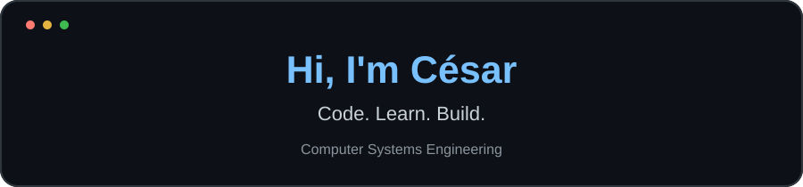

  

  

  <b>Computer Systems Engineering student</b> 
  Software development · Linux · Cybersecurity · Continuous learning

---

## About me

Hi! I'm **César López**, a Computer Systems Engineering student from Mexico.

- I enjoy building applications and learning how things work.
- I work with C#, Python, JavaScript and SQL.
- I'm currently learning JavaScript and React.
- I'm interested in software development, Linux and cybersecurity.
- I'm exploring secure software development and computer networks.

---

## Chess Replay

  

---

## Languages & Tools

  

  
    HTML · CSS · JavaScript · Python · C# · SQL (MySQL / SQL Server) 
    Linux · Git · GitHub · Docker · VS Code · Visual Studio
  

---

## GitHub Statistics

  

---

## Language Stack

  

---

## Featured Projects

  

---

   
  <b>Thanks for stopping by!</b> 
  One commit at a time.

